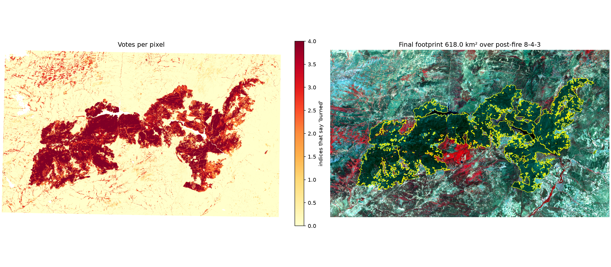
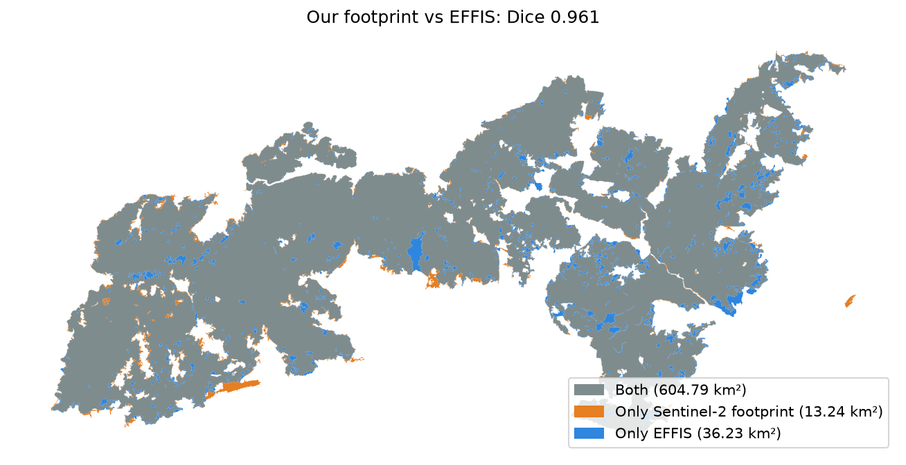
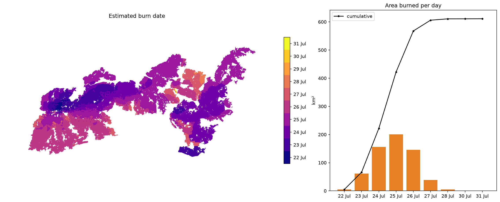

🇪🇸 Español | 🇬🇧 [English](README_en.md)

# Huella de los incendios de julio de 2026 en Ávila, Madrid y Toledo

Cartografía de la superficie quemada por el complejo de incendios de Burgohondo, Almorox y la Sierra Oeste
de Madrid, a partir de imágenes del satélite **Sentinel-2** tomadas antes (24 de junio) y después (8 de agosto
de 2026) del fuego. Todo el flujo está en cuadernos de Python, paso a paso y comentados, para que cualquiera
pueda repetirlo, comprobarlo o adaptarlo a otro incendio.



## Resultados principales

| Medida | Resultado |
|---|---|
| Superficie quemada (Sentinel-2) | **618,03 km²** (61.803 ha) |
| Por provincia | Ávila 386,07 km² · Madrid 219,41 km² · Toledo 12,54 km² |
| Municipios afectados | 30 de los 78 de la zona de estudio |
| Coincidencia con el perímetro oficial europeo (EFFIS) | 97,9 % de la huella dentro de EFFIS; detecta el 94,3 % de su superficie; índice de Dice **0,961** |
| Red Natura 2000 | 502,73 km² (81,3 % de la huella) dentro de espacios protegidos |
| Severidad (dNBR) | 12,4 % alta · 25,5 % moderada-alta · 33,5 % moderada-baja · 27,9 % baja |
| Primera detección por satélite | 22 de julio, 15:35 hora local (VIIRS) |
| Día de mayor avance | 25 de julio, unos 200 km² en un solo día |

La huella coincide casi por completo con los perímetros de EFFIS (641 km²). Las cifras publicadas en prensa
(más de 500 km² en Ávila y 268,6 km² en Madrid) son mayores que ambos mapas y proceden de otras fuentes y fechas.

| Comparación con EFFIS | Avance diario estimado |
|---|---|
|  |  |

## Cómo funciona

El método es una **detección de cambios**: se compara la vegetación antes y después del incendio con cuatro
índices espectrales (NBR, NDVI, BAI y GEMI). Un píxel se marca como quemado cuando varios índices coinciden, y
después se limpia el resultado (filtro de mayoría, eliminación de manchas pequeñas). Automatiza en Python el
procedimiento que en clase se hizo a mano en ArcGIS Pro (Calculadora ráster, Reclasificar, Filtro de mayoría,
Ráster a polígono, Disolver).

| Cuaderno | Qué hace | Resultado principal |
|---|---|---|
| `00_start_here` | Comprueba el entorno y muestra la zona de estudio | Mapa de la zona |
| `01_find_scenes` | Busca las imágenes Sentinel-2 sin nubes antes y después | `step1_scenes.json` |
| `02_reflectance` | Descarga las bandas y enmascara nubes y agua | Reflectancias pre y post |
| `03_indices` | Calcula NBR, NDVI, BAI y GEMI y sus diferencias | `dNBR.tif` y demás |
| `04_footprint` | Umbrales, votación entre índices y limpieza | `burn_footprint.gpkg` / `.kml` |
| `05_impact` | Severidad, cubierta del suelo, municipios, edificios, Natura 2000 | `step5_impact.json` |
| `06_fire_weather` | Tiempo de los días de ignición frente a la normal 1991-2020 | `step6_fire_weather.png` |
| `07_validation_effis` | Comparación con los perímetros oficiales de EFFIS | `step7_validation.json` |
| `08_progression` | Avance día a día con los focos de calor de NASA FIRMS | `step8_progression.json` |

Los ajustes comunes (zona de estudio, fechas, umbrales) están en `notebooks/common.py`. Si se cambian ahí,
todos los cuadernos los usan.

## Cómo reproducirlo

1. **Instalar Python** (probado con la versión 3.14) y crear el entorno:

   ```powershell
   python -m venv .venv
   .venv\Scripts\python -m pip install -r requirements.txt
   ```

2. **Pedir una clave gratuita de NASA FIRMS** (solo para el cuaderno 08) en
   https://firms.modaps.eosdis.nasa.gov/api/map_key/ y guardarla en un archivo `.env` en la carpeta del
   proyecto:

   ```
   FIRMS_MAP_KEY=tu_clave
   ```

   `.env` está en `.gitignore`, así que la clave nunca se publica.

3. **Descargar las capas de referencia** (municipios, Natura 2000, núcleos de población, ríos y edificios del
   Catastro) después del cuaderno 04, desde la carpeta `notebooks`:

   ```powershell
   ..\.venv\Scripts\python fetch_overlays.py
   ```

4. **Ejecutar los cuadernos en orden**, del 00 al 08. En VS Code basta con abrir la carpeta del proyecto y
   elegir el entorno `.venv`. Todo se descarga de servicios públicos (Microsoft Planetary Computer, EFFIS,
   NASA FIRMS, Open-Meteo). Los resultados se guardan en `outputs_madrid_avila/`.

5. **Opcional:** `python estimate_emissions.py` (en `notebooks`) estima el monóxido de carbono y las
   partículas emitidas a partir de la superficie quemada por tipo de cubierta.

Una ejecución completa de los cuadernos tarda unos 25 minutos.

## Limitaciones

- **La huella es una estimación por satélite**, con píxeles de 10 a 20 m. No sustituye al perímetro oficial.
- **El avance diario es aproximado.** Cada zona recibe la fecha del foco de calor más cercano; los satélites
  pasan unas seis veces al día y el humo puede ocultar focos.
- **Las emisiones son un orden de magnitud**, no una medición: CO ≈ 247.600 t (rango del 5 al 95 %:
  36.500 a 772.600 t); PM2,5 ≈ 39.700 t (3.900 a 134.000 t). Usan factores medios de la bibliografía, no
  específicos del encinar y pinar mediterráneo.
- **Los datos de calidad del aire** del panel interactivo son provisionales (Agencia Europea de Medio
  Ambiente) y su procesado todavía no está incluido en este repositorio.
- **El tiempo meteorológico** del cuaderno 06 corresponde a un único punto en el centro de la zona.

## Fuentes de datos

- Imágenes **Copernicus Sentinel-2** L2A, vía Microsoft Planetary Computer
- Perímetros de incendios de **EFFIS** (Copernicus, Sistema Europeo de Información sobre Incendios Forestales)
- Focos de calor **VIIRS** de **NASA FIRMS**
- Cubierta del suelo **ESA WorldCover 2021**
- Límites municipales y núcleos de población del **IGN**; edificios del **Catastro** (INSPIRE)
- Espacios **Red Natura 2000** (Agencia Europea de Medio Ambiente)
- Meteorología **ERA5** vía **Open-Meteo**

Si reutilizas los resultados, cita estas fuentes.

## Origen

Este proyecto parte de la práctica *Aplicación 3 – Detección de cambios (Sierra de Gata)* de un curso de
SIG, y la amplía a un incendio real de 2026 con validación, impactos y avance diario. La primera versión,
con scripts independientes y solo la parte de Madrid, se describe (en inglés) en
[`docs/scripts_v1.md`](docs/scripts_v1.md).
