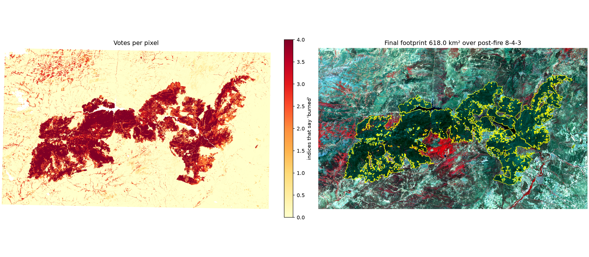
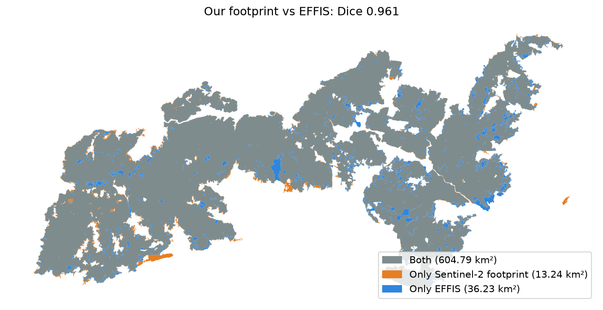
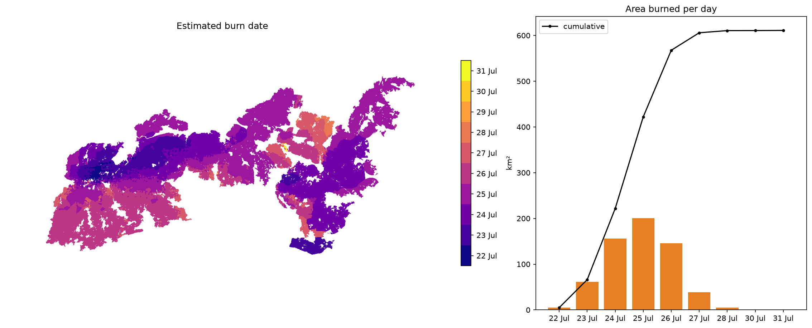

🇪🇸 [Español](README.md) | 🇬🇧 English

# Burn footprint of the July 2026 fires in Ávila, Madrid and Toledo

Mapping of the area burned by the Burgohondo, Almorox and Sierra Oeste de Madrid fire complex, using
**Sentinel-2** satellite images taken before (24 June) and after (8 August 2026) the fire. The whole
workflow is in commented, step-by-step Python notebooks, so anyone can repeat it, check it or adapt it to
another fire.

🗺️ **[Interactive map of the fire's spread](https://superhophop.github.io/Huella_Incendios_Julio_2026/)** (in Spanish)



## Main results

| Measure | Result |
|---|---|
| Burned area (Sentinel-2) | **618.03 km²** (61,803 ha) |
| By province | Ávila 386.07 km² · Madrid 219.41 km² · Toledo 12.54 km² |
| Municipalities affected | 30 of the 78 in the study area |
| Agreement with the official European perimeter (EFFIS) | 97.9% of the footprint inside EFFIS; finds 94.3% of its area; Dice score **0.961** |
| Natura 2000 | 502.73 km² (81.3% of the footprint) inside protected sites |
| Severity (dNBR) | 12.4% high · 25.5% moderate-high · 33.5% moderate-low · 27.9% low |
| First satellite detection | 22 July, 15:35 local time (VIIRS) |
| Day of fastest spread | 25 July, about 200 km² in a single day |

The footprint matches the EFFIS perimeters (641 km²) almost completely. Figures published in the press
(more than 500 km² in Ávila and 268.6 km² in Madrid) are higher than both maps and come from other sources
and dates.

| Comparison with EFFIS | Estimated daily spread |
|---|---|
|  |  |

## How it works

The method is **change detection**: vegetation before and after the fire is compared with four spectral
indices (NBR, NDVI, BAI and GEMI). A pixel is marked as burned when several indices agree, and the result is
then cleaned (majority filter, removal of small patches). It automates in Python the procedure done by hand
in ArcGIS Pro in class (Raster Calculator, Reclassify, Majority Filter, Raster to Polygon, Dissolve).

| Notebook | What it does | Main output |
|---|---|---|
| `00_start_here` | Checks the environment and shows the study area | Map of the area |
| `01_find_scenes` | Finds cloud-free Sentinel-2 images before and after | `step1_scenes.json` |
| `02_reflectance` | Downloads the bands and masks clouds and water | Pre and post reflectance |
| `03_indices` | Computes NBR, NDVI, BAI and GEMI and their differences | `dNBR.tif` and others |
| `04_footprint` | Thresholds, voting between indices and clean-up | `burn_footprint.gpkg` / `.kml` |
| `05_impact` | Severity, land cover, municipalities, buildings, Natura 2000 | `step5_impact.json` |
| `06_fire_weather` | Weather on the ignition days vs the 1991–2020 normal | `step6_fire_weather.png` |
| `07_validation_effis` | Comparison with the official EFFIS perimeters | `step7_validation.json` |
| `08_progression` | Day-by-day spread from NASA FIRMS hotspots | `step8_progression.json` |

Shared settings (study area, dates, thresholds) are in `notebooks/common.py`. Change them there and every
notebook uses them.

## How to reproduce it

1. **Install Python** (tested with version 3.14) and create the environment:

   ```powershell
   python -m venv .venv
   .venv\Scripts\python -m pip install -r requirements.txt
   ```

2. **Get a free NASA FIRMS key** (only for notebook 08) at
   https://firms.modaps.eosdis.nasa.gov/api/map_key/ and save it in a file called `.env` in the project
   folder:

   ```
   FIRMS_MAP_KEY=your_key
   ```

   `.env` is listed in `.gitignore`, so the key is never published.

3. **Download the reference layers** (municipalities, Natura 2000, settlements, rivers and Catastro
   buildings) after notebook 04, from the `notebooks` folder:

   ```powershell
   ..\.venv\Scripts\python fetch_overlays.py
   ```

4. **Run the notebooks in order**, from 00 to 08. In VS Code, open the project folder and choose the
   `.venv` environment. Everything is downloaded from public services (Microsoft Planetary Computer, EFFIS,
   NASA FIRMS, Open-Meteo). Results are saved in `outputs_madrid_avila/`.

5. **Optional:** `python estimate_emissions.py` (in `notebooks`) estimates the carbon monoxide and particles
   emitted, from the burned area of each land-cover type.

6. **Web map:** `python build_webmap.py` (in `notebooks`) rebuilds the interactive map data in
   `docs/data/`. The page `docs/index.html` is published with GitHub Pages.

A full run of the notebooks takes about 25 minutes.

## Limitations

- **The footprint is a satellite estimate**, with 10 to 20 m pixels. It does not replace the official
  perimeter.
- **The daily spread is approximate.** Each area gets the date of the nearest hotspot; satellites pass about
  six times a day and smoke can hide hotspots.
- **Emissions are an order of magnitude**, not a measurement: CO ≈ 247,600 t (5–95% range: 36,500 to
  772,600 t); PM2.5 ≈ 39,700 t (3,900 to 134,000 t). They use average factors from the literature, not ones
  specific to Mediterranean holm oak and pine forest.
- **The air quality data** in the interactive dashboard are provisional (European Environment Agency), and
  their processing is not yet included in this repository.
- **The weather** in notebook 06 is for a single point at the centre of the study area.

## Data sources

- **Copernicus Sentinel-2** L2A images, via Microsoft Planetary Computer
- Fire perimeters from **EFFIS** (Copernicus, European Forest Fire Information System)
- **VIIRS** hotspots from **NASA FIRMS**
- **ESA WorldCover 2021** land cover
- Municipal boundaries and settlements from **IGN** (Spain's national mapping agency); buildings from
  **Catastro** (INSPIRE)
- **Natura 2000** sites (European Environment Agency)
- **ERA5** weather via **Open-Meteo**

If you reuse the results, please cite these sources.
